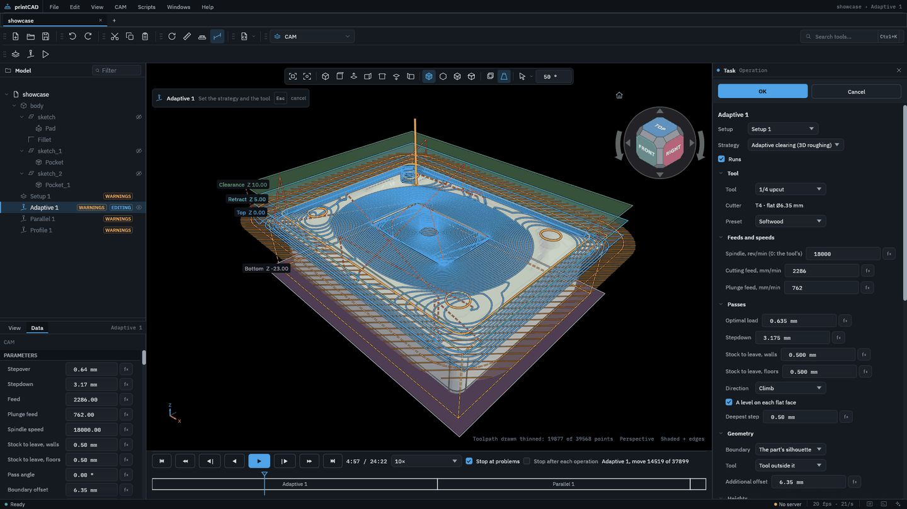
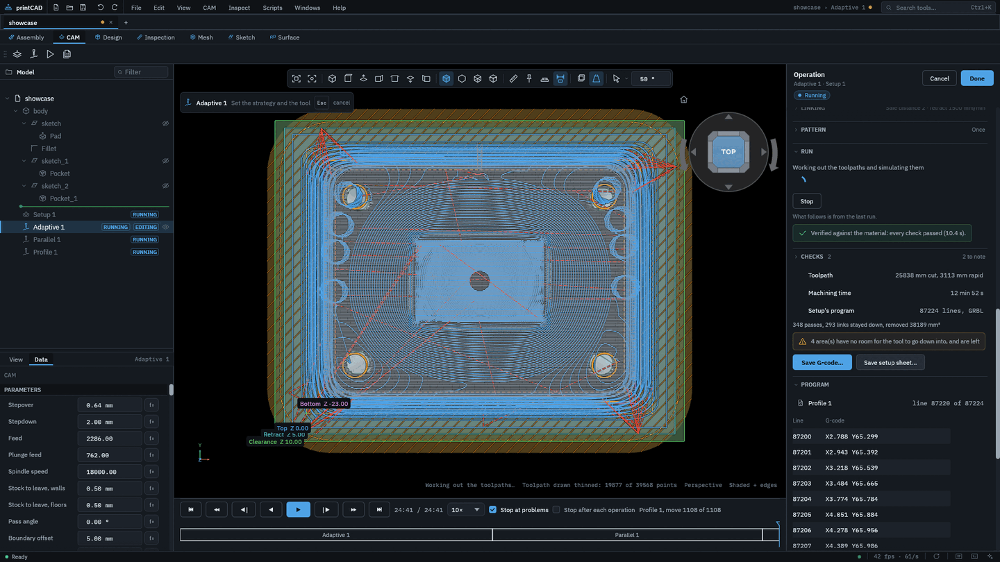
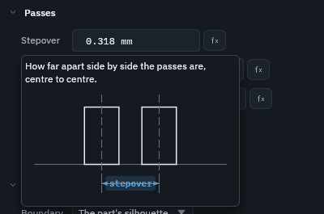
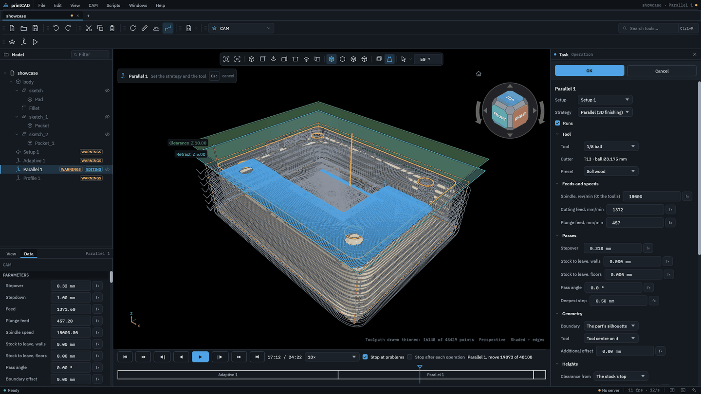

# CAM: 3-axis CNC milling for printCAD, with camcraft

A workbench package for [printCAD](https://github.com/gilbertorconde/printCAD)
that machines the document's solids: make a setup on the bodies, add
operations, and each setup's toolpaths are worked out, simulated against the
material, checked, and saved as G-code. The machining is
[camcraft](https://github.com/dan335/camcraft)'s, run natively on every core.



> [!WARNING]
> **Use at your own risk.** camcraft is pre-alpha and has not been proven on a
> real machine. Its G-code can be wrong in ways that crash the machine, break
> tools, ruin the part or hurt someone. Check every program yourself before it
> cuts: in a simulator you trust, then as an air cut above the stock, with a
> hand near the e-stop. The software comes with no warranty (see the licences).

## Based on camcraft

The machining in this workbench is
[camcraft](https://github.com/dan335/camcraft) by
[dan335](https://github.com/dan335): open-source CAM for 3-axis CNC routers,
written in Rust, whose operations, settings and programs follow Fusion's. Its
engine is copied into `camcraft/` (from camcraft 0.2.0; `camcraft/README.md`
says which commit and what is changed here), under its MIT or Apache-2.0
licences. Bugs in the toolpaths, the simulation or the posts are best fixed,
and reported, there; this package is the printCAD side: the document, the
panels, the drawing and the helper that runs camcraft.

## What it does

- **Setups.** A setup (`io.github.gilbertorconde.cam.setup`) names the bodies
  it machines, its stock (a box round them with margins, or one of a fixed
  size, or a cylinder: round bar up the tool, as a disc, or lying along the
  machine's X or Y, round the bodies with a margin all round and at each end,
  or of a fixed diameter and length centred on them), how the part sits (the
  tool axis along any of the six directions, or tilted, below),
  its work zero (a corner or the middle of the stock or of the bodies, or the
  document's origin, plus an offset), its post and its tolerance. New setup on
  the toolbar makes one on the selected body, or on every shown one.
- **Stock from an earlier setup,** as Fusion's "Continue from previous
  setup": a setup's stock can be what the setup before it in the document
  leaves, or a named earlier one, after its last operation: the same
  material, turned as this setup sees the part, which may be turned over or
  tilted. Its box is the box round that material, which a work zero on the
  stock is placed on. The checks, the simulation, playback, rest machining
  and the times all start from it, so a rapid through what the first side
  cut away is not a failed check on the second, and roughing the second
  side does not cut air. The earlier setup runs first, and a setup runs
  again when the one it carries on from changes; one turned off leaves
  nothing, and the setup carrying on from it says so. The setup sheet says
  which setup the stock comes from. The helper keeps what each
  setup left, so the next takes it from there; otherwise it runs the
  earlier one again for it. Each column of material is kept as one stretch,
  from its bottom up to its top, so turned over it is the same material;
  seen from the side, or tilted, a pocket hidden inside the material along
  the new tool axis is taken as material, never the other way round.
- **Stock from a body,** as Fusion's "From solid": a setup's stock can be a
  body of the document, a casting, a blank cut before or a printed part
  near its net shape. It is not machined: the setup starts from its
  material as the setup sees it, each column from the lowest the body
  comes over it to the highest along the tool, so a pocket cast open from
  above is air and roughing does not cut it again (adaptive clearing
  clears what stands, not the box round it); one hidden inside the
  material, out of the tool's reach, is taken as material. Its box is the
  stock's, which a work zero on the stock is placed on. The checks, the
  simulation, playback and the times start from it, and the setup sheet
  names the body.
- **Several parts, each at its own work offset,** as on two vises or a
  fixture plate's stations: a setup's Parts lists more, each at a work
  offset of its own (`G55`, `G56`…) and as far from the first, the part as
  the document has it at the setup's own offset, along the setup's axes;
  Add a part takes the next offset the post has, as far on as the last two
  are apart. The same operations are cut at each, and posted at each:
  in one program by tool, each run of operations with one tool at every
  part before the next tool, as Fusion's "WCS order by tool", or by part,
  every operation at one part before the next; one program an operation
  cuts it at each in turn. Between two parts the tool, still turning, is
  sent clear as the profile's `safe_retract` takes it, the next offset is
  selected, and it starts again from there; a profile with no
  `safe_retract` cannot change offsets in one program. The program reads
  back section by section, each on its offset. Each part is simulated as
  the first, since each is cut the same in its own coordinates; what
  differs is checked at each: the fixtures, against the toolpath where
  that part is, and the travel, where its work offset is on the machine
  (each known one's own, else the first's moved as far). Stocks so close
  they overlap are a warning. The view draws each part's stock and work
  zero; playback is the first part's; the machining time is every part's;
  the setup sheet lists each part's offset.
- **Tilted setups (3+2).** A setup's tool axis can be any direction: out of
  a flat face picked on the part, along a straight edge picked on it (either
  way), the document's Z tilted by angles about its X and then its Y, or a
  direction typed in; each number takes a formula. Machine X is a document
  axis made square to the tool (X unless the tool lies nearly along it), or
  a straight edge picked on the part. Everything then happens square to the
  tool: the toolpaths, the heights, the simulation and the checks, and the
  stock, whose box round the bodies is round them as the tool sees them,
  its margins along the setup's axes, as a fixed box's size and a cylinder's
  axis are. A post with rotary axes stands the part up for each program,
  positioning only: `G0 A.. B..` before it cuts, with the tool sent clear
  first. Without them the part is fixtured tilted by hand, and the program's
  header names the tilt. Either way the program's coordinates are in the
  tilted frame: **set the work offset in the tilted frame**, or use the
  controller's tilted-plane feature where it has one. A tilt the rotaries
  cannot reach, or only past their limits, is a failed check that says
  so.
- **On a rotary (4th axis),** as Fusion's Wrap toolpath and rotary
  operations: a setup whose stock is a cylinder lying along its X or Y can
  be turned on a rotary about the cylinder's axis, A about X or B about Y,
  the tool pointing at the axis. Everything is then planned on the
  cylinder unrolled: along it, round it (millimetres round at the wrap
  diameter, the stock's unless given, so the angle is that over half of
  it) and out from its axis. A sketch is wrapped round it as drawn, flat
  over its top, its Y (or X) the distance round, so engraving, slots, 2D
  profiles and pockets and V-carving cut it round the bar, a line longer
  than the bar is round going on round it. Parallel finishing is rotary
  finishing there, the tool on its radius: passes along the bar, a
  stepover apart round it at the wrap diameter, the rotary indexing
  between them (an angle within 45° of 0), or one helix round it, a
  stepover along it each turn (within 45° of 90), from end to end of the
  part; given a stepdown, it roughs down from the stock's top a level at a
  time first. Each point is as near the axis as the tool comes without
  meeting the part as the simulation holds it, its side as well as its
  tip, so what it plans it verifies. The work zero is on the axis,
  across it: Y0 Z0 (or X0 Z0), Z out from the axis. Its program moves X,
  Z and the rotary at once, each move fed in inverse time (`G93`, its own
  `F` one over its minutes along the material at the tool's tip) or,
  where the profile says `feed = "degrees"`, in units a minute counting
  the degrees as lengths, so it takes as long as cutting at its feed; arcs
  are written as straight moves. A profile names the rotary as for 3+2,
  with `continuous = true` for one that turns on without end (its limits
  are otherwise checked, as the travel), and `unwind = true` to start each
  operation within half a turn of zero rather than of where the last
  ended:

  ```toml
  [rotary]
  axes = ["A"]
  feed = "inverse-time"   # or "degrees"
  unwind = false
  [rotary.A]
  continuous = true
  ```

  GRBL has no rotary (a fork such as grblHAL may add an A axis, in a
  profile of your own); a setup on one posted for it, or for a machine
  without a rotary about the bar's axis, is a failed check that says so,
  and Klartext is not written turning a rotary. The material is simulated
  round the bar, each column how far out it reaches from the axis, the
  tool on its radius cutting each column it reaches round it, and checked
  against the part unrolled; a column the tool's side leaves before its
  top, beside a wall, keeps its material, so less is taken there than
  was, never more. The shank and holder are not checked on a rotary, and a
  note says so. Faces and edges picked on the part, and the operations
  planned flat on it (clearing, facing, holes, the other 3D finishes),
  are refused there.
- **Operations**, after Fusion's: adaptive and pocket clearing; parallel,
  scallop, contour, flat, spiral, radial and morphed spiral finishing; 2D
  profiles and pockets; facing; drilling: at once, in pecks backing out,
  breaking the chip, spotting each hole to a diameter (only as deep as
  leaves it that wide at its top, with a spot drill's, countersink's or
  drill's point: "spot to 3 mm"), or tapping with a tap, right- or
  left-hand; holes milled with
  the side of a tool: bored down a helix (a millimetre a turn unless set),
  round once at the bottom, then finished at the wall in passes that go in
  and out along arcs; holes and round bosses cleared in circles, a hole's
  from its middle out and a boss's from a width out from it in, a
  stepover apart, a stepdown a level, each level entered down a helix at
  the ramp angle; and threads milled inside holes or on bosses with a
  thread mill, right- or left-hand, at a pitch, climbing up or down as
  the hand says, in radial passes and a spring pass, along helixes in
  and out along arcs, a multi-form mill cutting as many turns each time
  round as it has rows of teeth (a thread's groove, past the wall it is
  cut in, is meant, not a gouge). Their helixes are written as `G2` and
  `G3` with a `Z`; engraving along curves
  and edges, open or closed, at a depth (0.5 mm unless set), each ramped
  down along itself, round a closed one and back and forth along an open
  one, so it never lifts between its levels, its arcs written as `G2` and
  `G3`; slots along the same curves and edges, as wide as the tool, 3 mm
  deep unless set and a millimetre a level, both ways (back and forth,
  ramping down as an engraving does) or one way (each level from the
  start, lifting back, entered by a ramp along the slot or a plunge),
  their arcs arcs at every level; deburring and chamfering with a chamfer
  mill or V-bit along picked edges, a pocket's rim or a part's outline,
  each from its own height: as wide as asked (0.5 mm unless set), the
  tip a tip offset below the chamfer so its flank cuts it, the tool's
  centre beside the edge away from the material, as the part either side
  says, or flipped, and a cone too small for it a failed check; and
  V-carving closed areas, letters among them, with a V-bit down
  their middle, as deep as each is wide: past its deepest it cuts the walls
  that deep and leaves the flat floor between, and says so, for a flat end
  mill to clear. And Custom G-code, Fusion's Manual NC: lines of your own,
  typed a row at a time, written into the program where the operation
  stands in its setup: before the next operation's start (its stop, tool
  change and spindle), or, last in the setup, after the one before ends.
  It has no tool and no toolpath, and the simulation does not see it.
  Its lines take the same `@name@` placeholders as a profile's blocks
  (below), filled from the program it goes into. They may not move the
  machine or change a mode: an axis word, any G code but `G4` (a dwell),
  `M6`, `M2` or `M30` is a failed check, so a `G91` cannot make the rest of
  the program cut somewhere else; a subprogram or macro call (`O`, `M98`,
  `G65`, `M100` up) is a warning, as nothing reads what it does. After the
  lines the program stops the spindle and the coolant, and takes where the
  machine is as not known, as after a tool change. An operation
  (`io.github.gilbertorconde.cam.operation`) belongs to a setup and runs in the
  document's order, each against what the one before left. Drag one in the
  tree to run it sooner or later, or under another setup.
- **Patterns.** Any operation's toolpath can be repeated before it is
  linked: in rows along X and Y (so many, so far apart), round a centre
  (so many, over an angle, a whole turn by default), and mirrored about a
  line along the setup's X or Y through a point, the original kept; given
  together, the rows are copied round the centre and all of them
  mirrored. Each number takes a formula. Every copy is linked, cut into
  the material, simulated and checked, and drawn. A mirrored copy would
  cut conventional where the original climbs, so each of its rings, and
  each pass all at one level, is run the other way round; what cannot be
  (a ramp) is said. Adaptive clearing and pocket clearing, which the
  material steers, are worked out again for each copy, against the
  material where it is, as the copies before it left it, and with rest
  machining (pocket clearing always) as the operations before it left it
  too: a copy where an earlier cut took the material cuts no air there, and
  one where more stands than at the original goes down a helix rather than
  taking the tool's whole width; a mirrored one is worked out mirrored, so
  it climbs too. Without rest machining an adaptive clearing's copies clear
  the stock's blocks less what each other cut, so its original is what it
  is alone. Copies apart are worked out at once, on every core. A
  copy that goes further outside the stock than the original is a
  warning, and copies that find nothing to clear are said.
- **Probing, and depths corrected to it,** for engraving, PCB isolation
  and V-carving on a board that is not flat, or for setting the work
  zero. A probe operation touches a grid of points over the stock's top
  (or over picked faces or a boundary), so many columns and rows or no
  further apart than asked, an inset in from the edges: at each point a
  touch probe, a tool kind of its own that the spindle never turns, goes
  down from the retract height at the probe feed until it touches, no
  further than the probe depth below the top, and back up. It is written
  as `G38.2`, which stops the program if the probe never touches. On
  LinuxCNC the program logs each point to a file named after the
  operation, `(PROBEOPEN probe-grid.txt)` to `(PROBECLOSE)`; GRBL reports
  each over the serial line as `[PRB:x,y,z:1]`, in machine coordinates,
  so keep the sender's probe log and save it in work coordinates (take
  the work offset off, or use a sender's autolevel export). Masso,
  Centroid, Mach, Fanuc, Haas and Heidenhain are refused with a failed
  check: how they record what they probe is not known here. A profile of
  your own probes with `probe = "g38.2"` or `"g38.2-probeopen"`. A
  setup's Probed surface group then corrects Z from the results: Load
  probe results… reads a LinuxCNC log (x y z and the other axes a line)
  or a CSV of x, y, z, in the post's units and the setup's work
  coordinates, which must fill a grid, and keeps them in the document.
  Every move of every operation but a probe's goes up or down by the
  surface's height there, bilinearly between the points: a cut split no
  longer than the segment length (1 mm), an arc into straight pieces
  where the surface is not level under it (one point probed moves
  everything by it, arcs and all). Past the probed area the surface is
  taken as at its nearest edge, and the operation says how far it went.
  The simulation and the checks run on the corrected paths, against a
  stock and a part whose top follows the surface, the holder's too. A
  probe takes as long as its moves at the probe feed; the setup sheet
  lists the probe among the tools, where its points go, and the results
  the depths follow. A probe in one program with the cuts corrected to
  probe results is a failed check: that program would cut to what was
  probed before it, not to what it probes. Post one program per
  operation, or put the probe in a setup of its own, and load what it
  probed before posting the cuts.
- **Rest machining,** as Fusion's, on adaptive clearing: off unless
  ticked; on, it clears only what the operations before it in the setup
  left (from previous operations), say the corners a bigger tool could not
  reach, not the whole area again. Its adjustment leaves rest thinner than
  it alone, so it does not go round a sliver for nothing. Pocket clearing
  always clears only what is left.
- **Corner relief.** A 2D profile, pocket or slot can cut out each inside
  corner its tool leaves round, the tool's radius across, so a square part,
  a tenon or another sheet's tab, fits it. A dogbone goes into the corner
  halfway between its walls, as far as takes the tool's side to the
  corner's point: a round notch reaching it, about four tenths of the
  tool's radius at a square corner. A T-bone goes on along one wall into
  the other, the tool's radius at a square corner: the wall nearer the
  setup's X, or its Y, or the longer or the shorter wall, so the notch is
  hidden in the one that shows least. Only corners sharper than an angle,
  when one is given; corners the tool goes round, a curve's chords, and
  any already square within the tolerance are left. Every corner is
  relieved at every level and every pass round it, ramped or not, climbing
  or not, with leads and tabs, and in every copy of a pattern; the
  simulation cuts the notches, and the checks take what they cut past the
  part as meant, not as a gouge.
- **Picking in the view,** as camcraft's: a pick row in the panel arms it,
  and while it is armed, hovering shows what a click takes. An operation
  takes faces, and edges by the loop they go round at their height (an edge
  that is not level, alone; an engraving's, each alone, and those end to
  end followed as one); a click on a picked one takes it out. A hole
  operation (drilling, boring, circular, thread) takes a hole by its rim,
  or by its wall, whose rims are its top and its bottom; "Every hole as
  wide" takes every hole of the setup's bodies as wide as one picked, its
  axis along the tool, as Fusion's Select Same Diameter, or every boss as
  wide; and its holes are cut nearest first, by X then Y back and forth,
  or as picked. It can take
  the document's sketches too, ticked in its panel: what their closed loops
  enclose, or the loops themselves for an engraving. Given in a script,
  they are a 2D cut's outline and a 3D cut's boundary, so an adaptive
  clearing given one pocket's sketch clears that pocket alone. A sketch's text is its
  letters' outlines. Its open curves close nothing, and a package cannot
  read them, so only picked edges give an engraving an open curve. A setup's
  work zero can be a corner or a round edge's centre picked on the part,
  its tool axis a flat face or a straight edge, and its machine X a
  straight edge.
- **What an operation machines, drawn** while it is edited: its boundary as
  chosen, where the tool's centre may go against it, and, hatched, what the
  tool cuts outside the part or beside a 2D outline.
- **Heights**, as Fusion's Heights tab: the clearance, the retract, and the top
  and bottom it cuts between, each measured from the stock, the part, the work
  zero or the picked faces and edges. The view shows them as planes across the
  stock while the operation is edited.

  

- **Linking**, as Fusion's Linking tab: retract feed, retraction, safe and
  stay-down distances, ramps, the entry (helix, plunge or ramp), leads on and
  off each ring, and reordering. A value left unset is the strategy's own, and
  the panel says what that comes to for the tool.
- **Passes**, as Fusion's Passes tab: besides the stepover, depths, feeds and
  stock to leave, each strategy's own settings (slopes, order, centre and
  radii, spokes, pass extension, flat areas; a drill's peck, chip break
  distance and dwell, or a tap's pitch and hand), the deepest step,
  tabs to hold a profiled part, and finishing passes along a pocket's walls.
  Hovering the stepover, stepdown, stock to leave or a height shows a sketch
  of what it measures, as camcraft's hints do.

  
- **Tools.** Preferences › CAM holds the tool library, which starts as
  camcraft's twenty common router bits, each with presets for the materials
  it suits. The chosen tool's kind, dimensions and presets can be edited,
  and its holder: none, one of a dozen common ones (ER collet nuts, and ER
  collet chucks and side-lock holders on BT30, CAT40, BT40 and HSK63A, at
  typical sizes), or its own, a stack of segments each with its diameter at
  its foot and top and its length. A Fusion tool library exported as CSV or
  JSON imports into it, the JSON bringing each tool's holder. A touch
  probe is a kind of its own, its ball's diameter, which only a probe
  operation takes. Past the flat, ball and bull-nose end mills, the
  V-bit and chamfer mill, the drill and the thread mill, each kind is cut
  with its own shape, in the toolpaths, their gouge checks, the
  simulation and the shank check:
  - a **tapered** (or tapered ball) end mill: its diameter at the tip, its
    corner (half that for a ball), and its taper a side up its flute
    length, where it is widest. It finishes in 3D (parallel, scallop,
    contour, spiral, radial, morphed spiral) and engraves, stock to leave
    and all: where a wall or a slope is steeper than the taper, its flank
    holds it off, where a ball its tip's size would cut through. On a
    rotary it finishes round the bar as a ball does, its flank met
    radially;
  - a **face mill**: its diameter at the face, its inserts' corner, and its
    lead angle from the axis (0 square, 45 a 45° mill) up its cutting
    height. It faces and finishes flats, 95% of its flat a pass, and goes
    off the stock by its widest;
  - a **lollipop** and a **slot (key) cutter**: a head, a ball or a disc its
    cutting height thick, on a neck narrower than it. They undercut, in a
    2D profile or a slot at one height (multiple depths off, the bottom
    where it cuts), entered outside the material: in a profile, negative
    stock to leave beside takes the groove into the wall. The neck, from
    the head up, and the shank are checked against the material, so a neck
    too wide for the groove is a failed check. The simulation, which keeps
    one stretch of material a column, takes from it only what the neck's
    width takes from above: the material under an overhang stays in it.
    On a rotary they are refused: no undercut goes round a bar;
  - a **spot drill** (or centre drill, its pilot not modelled) and a
    **countersink**: a cone at its point angle, 90° unless given, with a
    tip. They drill, spot to a diameter (above), chamfer and engrave;
  - a **tap**: its thread's diameter, pitch and hand, and its chamfer,
    leading in from the thread's minor diameter at the tip. Tapping wants
    one at its pitch and hand, and a tap only taps;
  - an **engraving tool**: a V-bit with a round tip (its tip radius), which
    engraves and finishes, but neither V-carves nor chamfers.

  From Fusion, `tapered mill`, `face mill` (`TA` its lead), `lollipop
  mill`, `slot mill` (`LCF` its cutting height), `spot drill`, `center
  drill`, `counter sink` and `tap right hand` and `tap left hand` (`TP` its
  pitch) come in as these; a neck's diameter is read from `DN` (CSV
  `tool_shoulderDiameter` or `tool_neckDiameter`) and a tap's chamfer from
  `tip-length` (`tool_tipLength`), names not confirmed against a Fusion
  export. A boring bar or head is left out: boring here is helical, with
  the side of an end mill, which a single point cannot do. A setup takes a copy of a tool when an operation first cuts with it, so a document never
  depends on the machine it is opened on.
- **Templates,** as Fusion's: a setup, or some of its operations, kept to
  make again on another part. A template keeps the setup's stock, work
  zero, orientation, post, tolerance and programs, and each operation's
  strategy, tool, heights, linking, passes and pattern; not the bodies,
  what is picked on them, or probe results. Save as template is in a
  setup's and an operation's menu in the tree, and in a setup's Templates
  group, which also applies one: its operations added after the setup's
  own, and its stock, work zero and post taken too when asked (asked
  already for a setup with no operations). Setup from template on the
  toolbar makes a setup on the selected body, or every shown one, with
  that group first. An operation that cut what was picked waits for a
  pick on the new part, its badge saying "Needs a pick" and what, unless
  its template fills it by a rule: its boundary or outline the part's
  silhouette, or every hole of a diameter, which a hole operation taking
  every hole as wide as one picked keeps as the picked hole's. Each tool
  is the setup's, another setup's or the library's with the same number,
  kind and size (diameter, corner, angle), else one of the same size,
  else the template's own, added. Templates are JSON files, each saying
  its version, in the package's data folder (`templates/`), which an
  update keeps; Export… and Import… pass them on. Two come built in:
  aluminium with a 6 mm flat (face, adaptive rough, contour finish,
  chamfer) and a sheet part with a 1/4" upcut (adaptive clear, profile
  out on tabs).
- **Status in the tree.** Each setup and operation shows how its run went:
  running (with how far), done, warnings, failed, or out of date.
- **Turned off.** An operation, or a whole setup, can be turned off without
  deleting it: Turn off in its menu in the tree, Runs in its panel, or
  `enable` by script. An operation off stays in its setup but is not run,
  simulated, checked or posted, and the operations after it cut the
  material as if it were not there; a setup off is not run at all. Its
  icon is struck through, its badge says it is off, and turned off from the
  tree it is hidden, so it shows greyed and nothing of it is drawn; Turn on
  brings it back.
- **Checked against the material.** Every setup is simulated: a gouge, a rapid
  through material and the other failures camcraft checks for are listed in
  the setup's and the operation's panels, and a setup that fails is not
  posted (Save anyway exists, and says what it is).
- **Shank and holder.** What stands above a tool's flutes is checked as each
  move is simulated, cutting moves and rapids alike, against the material as
  it then stands: the cutter past its flute length, its shank from its
  shoulder up to its stickout, and each segment of its holder above that.
  Each that meets material is a failed check on the operation, marked on the
  timeline at the first move it does, saying how many moves, how far in,
  whether it is the part or stock left above it, and for the holder the
  stickout that would clear it ("holder segment 1 (Ø32.00) meets the part on
  12 move(s) from move 40, 8.30 mm into it: needs 38.3 mm stickout"). What
  the tool's lengths do not say is not checked, and a note says so. A
  lollipop's or slot cutter's neck is checked from its head up, and a
  tapered mill's body above its flutes as wide as its flank's top. A 3D
  finish (parallel, scallop, contour, flat, spiral, radial, morphed spiral)
  can be asked to Use shank and holder, as Fusion's: it leaves out the cuts
  where they would meet the part, and links round what it left out; the
  check still runs, for the stock an earlier operation left. Other
  operations are only checked.
- **Fixtures.** A setup can name the bodies that hold the part: vise jaws,
  clamps, a sacrificial board, tabs on the table. They are not machined
  and never cut: every move of every operation, cutting or rapid, is
  checked against each, the tool whole (its cutter, its body past the
  flutes, its shank and its holder), at each placement of the part, and
  one that meets it is a failed check naming the fixture, what of the tool
  met it and the first move it did, marked on the timeline ("holder segment
  1 (Ø32.00) meets the fixture 'Jaw' on 6 move(s) from move 212, 4.10 mm
  into it"). Each is drawn as the box round it, red where a tool meets it.
  A 3D finish can be asked to Avoid fixtures: it leaves out its cuts where
  the tool would meet one, as Use shank and holder does; the links round
  what it leaves out are the linker's, which goes by the material, not the
  fixtures, and are checked all the same.
- **Playback,** as camcraft's: while a setup or one of its operations is
  open, a transport under the view plays its run back. A timeline has a span
  per operation as long as it takes to run, with failed checks marked filled
  and warnings hollow; click or drag on it to go anywhere. Buttons go to the
  start, the operation before, a step back, play backwards, play, a step on,
  the next operation and the end, at ¼× to 10,000×. Playing stops by itself
  at problems (on unless turned off) or after each operation. The clock is
  machining time, as below. Keys: Space
  plays and pauses; J, K and L shuttle back, pause and forward (again for
  faster); Left and Right step (Shift: ten); Up and Down go to the operation
  before and after; Home and End; Minus and Equals change the speed.
  Once playing, the material is swept again at full resolution by the helper
  kept running for it (up to 600 points a side), and steps go a move at a
  time; until then, and where it cannot, the run's coarse moments play.
  The helper runs the setup from the same request as the run shown, even
  when the document has changed since without the setup running again,
  and its moves must end when the run's do; when they do not, playback
  stays coarse and says so, rather than step and seek to the wrong moves.
  The panel lists the program being played (the operation's own, or in a
  setup's panel the one under way): the lines round the playhead's,
  numbered, with its line marked, following it as it plays. Click a line's
  number to take the playhead to its move.

  

- **Machining time**, for each operation and the setup, in their panels:
  the moves at their feeds and rapids at the post's rates, each axis at
  its own, a move done when its slowest axis is, and no feed quicker than
  its axes go; and each tool change the program makes, at the post's time
  for one. Nothing speeds up or slows down, so a machine takes longer, the
  more so the shorter its moves, and the panel says so. A profile gives
  them as

  ```toml
  tool_change_seconds = 30   # chip to chip; left out, changes are not timed
  [rapid]                    # mm/min, whatever the program's units
  x = 5000                   # an axis left out: 5000
  y = 5000
  z = 3000
  ```

  Every built-in post has them, typical of its kind of machine (a hobby
  router's 5000 mm/min and a minute to change a tool by hand, a Haas VF's
  1000 in/min and five seconds), not of yours: its file says where your
  machine keeps its own. Copy it as a post of your own to set them.
- **Setup sheet,** as Fusion's: Save setup sheet…, beside Save G-code, writes
  what goes to the shop floor with the program as one HTML page to print,
  its style inside it. The part's and the stock's sizes and the stock's
  material (the setup's Material, under Stock), where the stock goes from
  the work zero, the work zero and its work offset, and where that is on
  the machine when the setup says; the tool axis, and what a tilt asks of
  whoever sets the part up; the post, the program's name and number; each
  tool with its number, kind (a thread mill with its pitches; a tapered
  mill's taper, a face mill's lead, a neck, a tap's pitch and hand), diameter, flutes, flute length, stickout and
  length, holder (its name and segments, `ER20: Ø28 × 19, Ø42 × 15 mm`),
  the operations that use it, the lowest it goes and the
  fastest it is fed and turned; each operation with its strategy, tool,
  speed and feeds, stepover, stepdown, stock to leave, the lowest and
  highest it goes, its time, and its own settings (a bore's helix, a
  thread's pitch and hand, a tap or a peck, rest machining, dogbones or
  T-bones, a pattern's copies), one turned off listed as off; the machining time, as above; and every
  failed check and warning. A setup that failed its checks has a sheet too,
  which says so first, at the top. The setup's panel lists its tools with
  what each does too.
- **Drawn over the model.** The stock's box or cylinder, the work zero, each operation's
  toolpath (rapids dashed while it is edited), and the material left. The
  view draws 30,000 of the toolpaths' points at most, so a frame stays
  quick on a big document: the edited operation's first, then the rest of
  its setup, then the other setups, each thinned to its share.
- **G-code through the save dialog,** one program for the whole setup, as
  Fusion posts one, or one program per operation (every one of a setup into
  a folder at once), as the setup's Programs says, for GRBL,
  Masso, Centroid CNC12 (Avid), LinuxCNC, Fanuc (0i, 31i), Haas (NGC) or
  Mach3 and Mach4, or in Klartext for a Heidenhain TNC, each in millimetres
  or inches, or through a
  machine profile of your own in camcraft's TOML, which a setup carries a
  copy of. A setup's program has one header and one footer, and each
  operation in order under a comment naming it: the tool is changed only
  where it changes, the same tool kept turning, at the next operation's
  speed where that is another, and the coolant changed only where it
  changes. Between operations the tool goes up clear as the profile's
  `safe_retract` takes it, or, with none, straight up as high as either
  operation goes, across, and down. The work offset is the setup's, and
  written once. Custom G-code between two operations
  is written with the spindle stopped and the tool clear, and the next
  starts again after it, its tool changed. A profile with
  `optional_stop = true` stops between every two operations (`M1`), the
  spindle stopped first. The program is named after the setup and numbered
  as its Program number says (`@number@`, 1001 unless set); one per
  operation is named `setup-01-operation` and numbered on from it, one a
  program. The listing beside playback lists the setup's program whole,
  each line followed to the operation and the move it makes.
  Fanuc's and Haas's programs are tapes, `%` round them and an `O`
  number first, the setup's (`O1001`, Haas's `O01001`), and call up the
  next tool after a change (`T5` after `T3 M6`), where the profile says
  `preselect_tool = true`. A
  Heidenhain program (`.h`) is Klartext, not G-code (`dialect =
  "heidenhain"`): numbered blocks from `BEGIN PGM` to `END PGM`, named as
  its file is, which the control insists on, once however many operations
  the setup has, the stock once
  as `BLK FORM`, `TOOL CALL 3 Z S18000`, `L X+10 Y+5 R0 F1200` and `FMAX`,
  arcs by their centre (`CC`, then `C .. DR+`), a helix by its angle (`CP
  IPA+360 IZ-1`), the work offset as a preset row (`CYCL DEF 247`, G54 its
  first), feeds in tenths of an inch a minute in inches, and holes as
  `CYCL DEF 200`, `203` and `207` called at each by `M99`. It is read back,
  as every program is, and the same checks run on it. A profile can give the spindle's range (`spindle = [6000, 24000]`),
  and an operation whose tool turns outside it is warned about. It can give
  its travel, in the program's units, in the machine's own coordinates:

  ```toml
  [travel]
  coordinates = "machine"   # as G53 moves; left out, from the work zero
  x = [0, 600]              # any of x, y and z; an axis left out goes anywhere
  y = [-400, 0]
  z = [-120, 0]
  ```

  A setup then says where its work zero is on the machine, what its work
  offset holds (Machine X, Y and Z in its panel, each taking a formula), and
  its programs are checked there. With tool length offsets (`G43`, a
  profile's `length_offset`), Machine Z is the spindle's gauge line at the
  work zero, and each tool's length from the gauge line is added: what
  sticks out of its holder (its stickout, else its overall length) and the
  holder's segments, when it has one; without a holder the gauge line is
  taken at the collet. A tool of no known length leaves Z unchecked, and a
  note says so. Without length offsets, Machine Z is the tip's, touched off.
  A setup that does not say where its work offset is is not checked, and a
  note says so. A `G53` move of the profile's own (`safe_retract = ["G53 G0
  Z0"]`, a tool change, the park at the end) must be inside the travel, or
  the profile does not load. A tilted setup is checked along its own axes,
  which are the machine's once its rotaries have stood the part up, or as
  it is fixtured: its work offset is the one set with the part turned.
  The older form, without `coordinates`, still loads and means what it did:
  ranges from the work zero as you set it, whatever the work offset.
  A program that goes past the travel (its rapids and arcs counted) is a
  failed check on the operation that does, saying which axis, how far under
  or over, and in what coordinates: past its limits a machine stops part-way
  through the cut, or crashes into them, so it is refused before it gets
  there, like the simulator's failures (Save anyway still writes it).
  A setup picks its work offset from those its post has: `G54` to `G59`,
  and any past them the profile lists (`extended_offsets = ["G59.1",
  "G59.2", "G59.3"]` on LinuxCNC, Fanuc's `G54.1 P1` to `P48`, Haas's
  `G154 P1` to `P99`), which its programs select. The lines a profile gives, `header`, `footer`,
  `safe_retract`, `end_home` and its own tool change, `tool_change_lines`
  (written in place of `T.. M6` or the pause, and naming `@tool@`), take
  placeholders: `@name@` (the program), `@number@` (its number),
  `@operation@`, `@strategy@`,
  `@tool@`, `@tool_comment@`, `@rpm@`, `@spindle@` (`M3` or `M4`),
  `@coolant@` (`flood`, `mist`, `off`), `@coolant_code@` (`M8`, `M7`, `M9`),
  `@units@`, `@units_code@` (`G21`, `G20`), `@wcs@` (`G54`…) and `@date@`
  (the day it was posted); `@@` is an `@`, and `{name}` still the program's
  name. In a setup's program each operation's lines are filled with its own,
  the header with the first's and the footer with the last's. A placeholder that is not one makes the profile invalid: adding it
  says which and on which line, and a setup carrying a copy that no longer
  loads says so in its panel. A profile
  that takes canned cycles (`drill_cycles = true`) writes each hole as one:
  G81, G82 with a dwell, G83 pecking, G73 breaking the chip (backing off as
  far as the controller is set to), and G84, or G74 left-hand, tapping at the
  pitch times the spindle's speed; without them holes go as plain moves. The
  LinuxCNC, Centroid CNC12 and Masso posts write them (Masso's G82 pause in
  milliseconds, `dwell_milliseconds = true`, as Fanuc's); the others write
  plain moves, GRBL having no cycles. A tap goes only as the controller
  taps, since no plain move keeps the feed to the spindle as it reverses at
  the bottom, and `tap` says how, whether or not the other cycles are on:
  `"g84"` (G84 and G74, the default with cycles; in Klartext, cycle 207,
  which `"cycle"` also names), `"m29"` (G84 and G74 after `M29 S..`, Fanuc's
  rigid tapping), `"g33.1"` (rigid tapping a hole at a time, the spindle
  reversing itself: `G33.1 Z.. K` with the pitch) or `"none"`. LinuxCNC taps
  with G33.1, which needs a spindle encoder; Fanuc in rigid mode after
  `M29`; Haas with G84 and G74, which it taps rigidly by itself; Heidenhain
  with cycle 207; CNC12 with G84 and G74, which needs its rigid tapping (an
  encoder and the Pro licence on an Acorn) or a floating tap holder. Masso,
  GRBL and Mach cannot (Mach4's G84 is for a floating holder, not kept to
  the spindle): a tapping operation posted for them is a failed check that
  says so, and names the machines that can. A tap is a kind of tool of its
  own (above), at the pitch and hand the operation taps; a document from
  before, that taps with a flat end mill its size, still taps, and a
  warning says to make the tool a tap. It turns the way its thread does.
  A thread mill is a kind of its own: its cutting diameter, its tip below
  the teeth, the pitches it cuts, and its rows of teeth.
  A profile can name its rotary axes, for 3+2 machining:

  ```toml
  [rotary]
  axes = ["A", "B"]     # from the machine's base out: A carries B, B the part
  [rotary.A]
  about = "x"           # the machine axis it turns about: x for A, y for B unless said
  sign = -1             # 1: a positive angle turns the part right-handed about it
  limits = [-30, 110]   # degrees; a full turn either way unless said
  ```

  With every rotary at zero the part sits as modelled. With two, the setup's
  machine X must lie where they leave the machine's X; a check says which
  way that is when it does not. A profile with rotaries needs a
  `safe_retract`, since the part turns under the tool.
- **Formulas.** Every number of a setup and of an operation takes a formula.
- **Script commands**, for scripts and AI agents:

```lua
local cam = pc.io.github.gilbertorconde.cam
local setup = cam.setup{bodies = {"<body id>"}, margin = 3, post = "grbl"}
local each = cam.setup{bodies = {"<body id>"}, programs = "operation", number = 2000}
                                        -- one program an operation, O2000 on
local plate = cam.setup{bodies = {"<body id>"}, material = "6061 aluminium"}
local disc = cam.setup{bodies = {"<body id>"}, stock = "cylinder", axis = "tool",
                       diameter = 80, length = 25}  -- or margin = 3 round the bodies
local side = cam.setup{bodies = {"<body id>"}, tool_axis = "-y", machine_x = "+x"}
local placed = cam.setup{bodies = {"<body id>"}, post = "linuxcnc", wcs = "G59.1",
                        work_offset = {x = 250, y = -180, z = -95}}  -- in machine coordinates
local cast = cam.setup{bodies = {"<body id>"}, stock = {solid = "<casting's body id>"}}
local held = cam.setup{bodies = {"<body id>"}, fixtures = {"<jaw id>", "<clamp id>"}}
local vises = cam.setup{bodies = {"<body id>"}, post = "linuxcnc",
                        parts = {{wcs = "G55", x = 150}}, order = "tool"}
                                        -- or parts = {count = 4, x = 120}: G54 to G57
local tilted = cam.setup{bodies = {"<body id>"}, tilt = {x = 30, y = 0}}
local rotary = cam.setup{bodies = {"<body id>"}, stock = "cylinder", axis = "x",
                         post = "my-4-axis", wrap = {diameter = 40}}  -- or wrap = true
                                        -- or tool_axis = {x = 0, y = -0.5, z = 0.866}
local rough = cam.operation{setup = setup.feature, strategy = "adaptive", tool = "1/4 upcut",
                           heights = {bottom_from = "model-top", bottom = -6}}
local corners = cam.operation{setup = setup.feature, strategy = "adaptive", tool = "1/8 upcut",
                              sketches = {"<sketch id>"},
                              boundary = {kind = "selection", containment = "inside"},
                              passes = {rest = true, rest_adjustment = 0.2}}
local name = cam.operation{setup = setup.feature, strategy = "engrave", tool = "60° V-bit",
                           sketches = {"<sketch id>"}, passes = {depth = 0.4}}
local keyway = cam.operation{setup = setup.feature, strategy = "slot", tool = "1/4 upcut",
                             sketches = {"<sketch id>"}, pattern = "directional",
                             passes = {depth = 4}, stepdown = 1}
local three = cam.operation{setup = setup.feature, strategy = "pocket", tool = "1/4 upcut",
                            transform = {linear = true, x_count = 3, x_spacing = 25,
                                       mirror = true, mirror_axis = "x", through_y = 0}}
local deburr = cam.operation{setup = setup.feature, strategy = "chamfer", tool = "90° V-bit",
                             passes = {chamfer_width = 0.8, tip_offset = 0.3}}
local letters = cam.operation{setup = setup.feature, strategy = "v-carve", tool = "60° V-bit",
                              sketches = {"<sketch id>"}, passes = {max_depth = {value = 2, given = true}}}
local holes = cam.operation{setup = setup.feature, strategy = "thread", tool = "M8 thread mill",
                            faces = {{body = "<body id>", at = {10, 10, -3}}},
                            holes = {same_diameter = true, order = "x-then-y"},
                            passes = {thread_pitch = 1.25, thread_passes = 2}}
local grid = cam.operation{setup = setup.feature, strategy = "probe", tool = "2 mm probe",
                           passes = {probe_x_count = {value = 5, given = true},
                                     probe_y_spacing = 15, probe_depth = 2}}
local board = cam.setup{bodies = {"<body id>"}, post = "linuxcnc",
                        probe_map = {path = "/home/me/linuxcnc/probe-grid.txt"}}
                                        -- or text = the file's contents; segment = 0.5
local clamps = cam.operation{setup = setup.feature, strategy = "custom-gcode",
                             gcode = "M0 (move the clamps for @operation@)\nM7"}
cam.status{id = setup.feature}          -- queued, running, ready (with its checks), failed
cam.import_tools{text = fusion_csv}     -- a Fusion tool library, exported as CSV
cam.add_post{text = profile_toml}       -- a machine profile of your own
local program = cam.gcode{id = setup.feature}  -- the setup's; an operation's id gives it too
local own = cam.gcode{id = each_op}             -- one program an operation: the operation's
local sheet = cam.setup_sheet{id = setup.feature}  -- its setup sheet, as HTML
cam.save_template{setup = setup.feature, name = "Plate", fill = {["pocket 1"] = "silhouette"}}
                                        -- or operations = {ids}; fill: pick, {holes = 6.8}
local made = cam.apply_template{template = "Plate", bodies = {"<other body id>"}}
                                        -- or setup = <id>: its operations appended
cam.templates{}                         -- built in and saved, with each operation's fill
```

## How it works

The package itself (WebAssembly, in printCAD's sandbox) keeps the setups and
operations, draws and shows what comes back, and saves the programs. A setup
runs as a job that hands it to the package's native helper,
`camcraft-helper`: a camcraft job with each body's B-rep as printCAD keeps it
(ogeom's native format). The helper tessellates the solids, runs camcraft's
one engine path (toolpaths, linking, simulation, checks, post) and answers
with the toolpaths, the checks and the programs. One setup runs at a time;
Stop kills the helper.

The package asks for the `helper` capability, to run that program outside the
sandbox. In a browser printCAD runs no helpers, so the package does nothing
useful there.

## What it does not do yet

- Rotary axes position a tilted part before each program cuts, or turn a
  setup on a rotary as it cuts, one rotary and two linear axes at once:
  nothing moves on five, and no tilted-plane code (`G68.2` and the like)
  is written. On a rotary, machining times take the moves unrolled, the
  rotary as fast as the other axes, and the travel is checked from the
  moves as posted on their own.
- A setup's run is not kept in the document. The helper keeps the newest 64
  runs in the user's cache folder (`printcad-cam`; `CAM_HELPER_CACHE` names
  another, or `off`), so a document opened again on the same machine shows
  its runs at once; elsewhere they run again.
- Picked faces and edges follow camcraft's rules: a pick is a point on the
  face, found again on the solid by that point.
- Custom G-code is checked word by word, not run: what a subprogram or
  macro it calls does is not known, only warned about. A profile's own
  blocks are written as it gives them, and only the built-in posts' are
  read back in the tests.
- The Fanuc, Haas, Mach and Heidenhain posts are written from their
  manuals and from how Fusion's posts write for them, and read back in the
  tests; none has been run on its machine yet. Klartext's arcs out of the
  XY plane turn as G-code's `G18` and `G19` do, a helix about X or Y is
  written as straight moves, and cycle 203 backs off 0.25 mm to break the
  chip, whatever the operation asks: `G73` says no distance either. There
  is no Siemens Sinumerik post yet.
- Machining time is the toolpath's: the moves a setup's program adds
  between two operations, a drill's dwell, the spindle getting up to
  speed and anything a machine does to speed up or slow down are not in
  it. A setup sheet has no picture of the part, as a package cannot take
  one of the view.
- Probing writes `G38.2` for LinuxCNC and GRBL only, and nothing reads
  GRBL's `[PRB:..]` reports, which are in machine coordinates. Results are
  corrected to as they are, from the work zero: the probe's ball touching
  a slope off its centre, and its trigger travel, are not allowed for.
- Travel is checked as a box of the program's moves, in the setup's
  frame: where the rotaries carry the part while they turn, the holder and
  the spindle against the part or the table, and a controller's own
  tool-change position (outside a `G53` move in the profile) are not
  checked.

## Install it

It needs printCAD 0.11 or later.

- From a release: download the `.pcbench` file from the
  [releases](https://github.com/gilbertorconde/PrintCAD-cam-wb/releases)
  and use Preferences › Workbench packages › Install from a file….
- From this repository: type its address,
  `https://github.com/gilbertorconde/PrintCAD-cam-wb`, on the same page and
  press Install. printCAD takes the latest release, checks for newer ones and
  offers to update.

A release carries the helper for Linux (x86_64, aarch64), macOS (Apple
silicon, Intel) and Windows (x86_64).

## Build it

With [rustup](https://rustup.rs), the toolchain and the `wasm32-wasip2`
target come from `rust-toolchain.toml`:

```sh
scripts/pack.sh                        # dist/io.github.gilbertorconde.cam-<version>.pcbench, with this machine's helper
cargo test --release -p cam -p camcraft-helper
cargo test --release --workspace       # camcraft's own tests too
```

To see what the package asks of the helper, start printCAD with
`CAM_HELPER_DUMP=/tmp/request.json`: the helper keeps the last request there,
and `camcraft-helper < /tmp/request.json` runs it again by hand.

## Release it

1. Set the same version in `bench.toml` and `Cargo.toml`.
2. Commit, tag and push: `git tag v0.2.0 && git push origin v0.2.0`.

The Release workflow builds the helper on each system, runs the tests, packs
them all with the package, checks that the tag names that version, and
publishes a GitHub release with the `.pcbench` attached. A tag with a suffix
(`v0.3.0-beta.1`) becomes a prerelease, which printCAD does not offer as an
update. Every push and pull request runs the CI workflow: format, clippy,
tests, the helpers, and the package as a build artifact.

## Layout

| Path | What it is |
| --- | --- |
| `bench.toml` | the manifest: id, version, feature kinds, capabilities |
| `src/lib.rs` | the workbench: tools, events, commands, the job |
| `src/data.rs` | a setup's and an operation's data, and the camcraft job they make |
| `src/panel.rs` | the task panels and the preferences page |
| `src/draw.rs` | what the view draws |
| `src/runs.rs` | the setups being run, one at a time |
| `src/sheet.rs` | a setup's sheet for the shop floor, as HTML |
| `protocol/` | what the package and the helper say to each other |
| `helper/` | `camcraft-helper`, the native program that machines |
| `camcraft/` | camcraft's engine, copied in (its README says from where) |
| `scripts/pack.sh` | build and pack a `.pcbench` |
| `.github/workflows/` | CI, the helpers on each system, a release for every `v*` tag |

## License

MIT or Apache-2.0, at your option. camcraft is dan335's, under the same
licences; `camcraft/NOTICE` says what else it holds.
